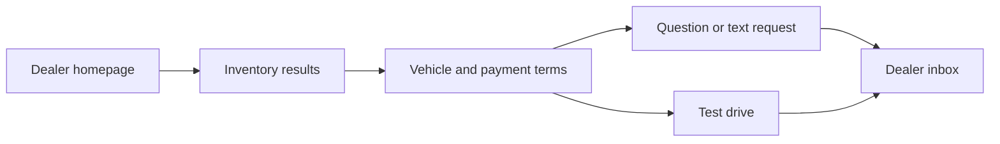
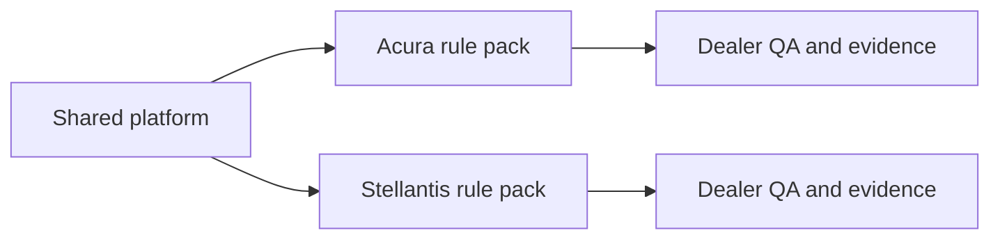

# AutoDealership.SI | OEM readiness and product roadmap

November 26, 2026 • Advanced Marketing • US dealership rollout

Dealer search visibility, reporting and Module 13 advertising have a dedicated [engineering roadmap](dealer-marketing.md) and [GitHub epic](https://github.com/bensblueprints/autodealership.si/issues/1).

## The product to build

An independent dealer should be able to publish a car, answer a shopper, book the visit and see who needs a response today. A franchise dealer should get the same experience with delivery into the CRM and DMS it already pays for. Use those deployments to assemble the evidence each manufacturer asks for.

**First sales demonstration.** A shopper finds a car within a weekly budget, opens the exact stock number, asks about cash down and books a visit. The salesperson sees the question, vehicle, trade-in and specific requests. The next milestone is a two-way text conversation from the dealership’s business number that a salesperson can take over and that ends in a recorded visit outcome.

**Why a dealer would switch.** DealerOn already sells AI chat tied to inventory and payments. DriveCentric already unifies sales conversations. Compete on how reliably a conversation becomes a kept appointment, including at a small Buy Here Pay Here lot. Demonstrate it on the dealer’s own inventory. [DealerOn Sidekick](https://www.dealeron.com/sidekick/) · [DriveCentric](https://drivecentric.com/products/engagement-hub)

**Business decision.** Use the PostgreSQL lead inbox as the first CRM. Keep the dealer’s existing accounting system and build authorized connectors around it. Sell websites to independents today, pilot AI on franchise dealers’ existing sites where allowed, and pursue website certification in parallel. Keep WHOP and the negotiated small-dealer plan. Measure messaging, DMS, data and support costs before quoting franchise replacements.

**Scope.** The baseline is the shared showroom, onboarding, billing and sales-site source, the supplied 16-module brief, primary-source research and release tests. “Working” identifies implemented behavior. “Partial” identifies the boundary. “Planned” means there is no verified end-to-end capability. An editable page can describe a service before software exists to perform it.

**Reading guide.** Pages 2–3 compare dealer systems and DealerOn features. Pages 4–5 audit the sixteen modules. Page 6 maps the customer site. Pages 7–8 specify CRM, DMS and AI texting. Pages 9–11 cover multi-OEM qualification, release gates and pilot measurement.

---

## 1 | Which dealer systems to compete with

| System and buyer | Why the incumbent wins | Our product decision |
|---|---|---|
| Website and merchandising / internet director | DealerOn bundles inventory, specials, SEO and OEM program participation. Dealer Inspire also sells websites to independents. | Compete directly. Demonstrate mobile stock lookup, transparent BHPH schedules, booking and a migration that preserves valuable URLs. |
| BDC and CRM / sales manager | DriveCentric puts text, calls, email and video in one workflow. Fullpath documents AI lead handling, the manager’s role and human intervention. | Build inbox ownership, follow-up tasks, missed-call recovery, appointment dispositions and channel history. Integrate with an existing CRM on request. |
| Inventory distribution / used-car manager | An authorized distributor can normalize DMS feeds across multiple destinations. Handling outages, permissions and deltas is the hard part. | Own the vehicle model, merchandising and reconciliation. Partner for access where the dealer’s agreement requires it. |
| Enterprise DMS / controller and service director | Tekion combines DMS, CRM, digital retail, service, payments and payroll. Controllers need reconciled financials and fixed ops needs repair orders and capacity. | Integrate first. Evaluate deeper service or accounting software only after signed demand, a domain lead and a migration budget. |
| BHPH servicing / owner and collections manager | DealerSocket iDMS serves post-sale accounts, delinquency queues, payment reporting and collections. | Own pre-sale affordability and conversion. Partner for servicing. A loan ledger, payoff quote and payment reversal are separate deliverables. |
| Digital retail and F&I / finance director | DealerOn Apex connects the shopper’s payment selection with an online deal. Data licensing, lender terms and dealer handoff determine usefulness. | Own the saved deal and continuity. Partner for licensed valuations, credit, lender decisions, e-sign and deposits. |

Product sources: [DealerOn Acura](https://www.dealeron.com/acura/) · [Dealer Inspire Unbound](https://www.carscommerce.inc/dealer-inspire/unbound/) · [DriveCentric](https://drivecentric.com/products/engagement-hub) · [Fullpath playbook](https://help.fullpath.com/hc/en-us/articles/54409652370964-Playbook-AI-Lead-Handling-Agent) · [DealerVault](https://www.authenticom.com/product/dealervault) · [Tekion ARC](https://tekion.com/products/arc/) · [DealerSocket iDMS](https://dealersocket.com/products/idms/account-management/)

---

## 2 | DealerOn parity backlog

DealerOn’s public US Acura website tiers are $1,599, $2,229 and $2,999 per month. Website, SEO and digital advertising bundles are $3,299, $4,699 and $7,199. Treat these as Acura program prices. Ask for scope, media spend and third-party charges when comparing proposals. Validate additional OEM-specific and privately sold features in dealer-authorized demos. [DealerOn program and feature schedule](https://www.dealeron.com/acura/)

| Public buying criterion | Where we stand | Evidence needed for parity |
|---|---|---|
| HTTPS, accessibility, compliant homepage, dedicated team | Hosting, branding and provisioning work. Assurance and service commitments are partial. | Versioned OEM template, accessibility evidence, named support owner and restore drill. |
| Inventory, exports and Search Valet | Intake, VIN, faceted search, voice and BHPH budgets work. | Reconcile real feed totals/deletes, acknowledge an export, measure failed stock and feature searches. |
| Specials, Symphony, Design Studio and video hero | Photo hero, slides, editable specials pages. | Approved offer record with expiry, versioned creatives, video fallback and automatic withdrawal across channels. |
| Local SEO, structured data and blog | Published-page hierarchy and sitemap. News is an editorial landing page. | Repeating articles, authors, revisions, live structured-data checks and crawl monitoring. |
| Loop alerts, send-by-text, eWallet and Lead Driver coupons | Favorites, inquiries and scoped text requests. | Subscriptions, price/stock alerts, vehicle sharing, coupon redemption and revocation. |
| Behavioral offers, geofencing and experiments | Planned. | Permission-aware audience selection, randomized holdout and measured incremental appointments. |
| PriceStak discounts, payments, affordability and locked offers | Cash, illustrative APR/lease and published BHPH schedules. | Region/lender rules, mutually exclusive rebates, disclosures, timestamped quotes and expiry. |
| Basic/advanced listings and reputation | Store-local hours, location and contact info. | Authorized directory sync, conflict handling, review approval and location-level reporting. |
| Data Hub, ROI and call tracking | Lead sources, appointment counts and web voice usage. | Trace campaigns, calls and inquiries to shown visits and matched sales. Reconcile spend and outcomes. |
| Apex, AI chat, compliance AI and group insights | Stock-grounded web chat/voice and booking. | Saved deal and lender handoff, versioned compliance findings and permissioned group reporting. |

**Beyond parity.** Preserve VIN, selected schedule, open question and appointment as a shopper moves from voice to text to staff. Show staff the source terms and booking receipt. Test against sold stock, expired offers, unavailable slots and a shopper who declines texts. [DealerOn AI products](https://www.dealeron.com/sidekick/)

---

## 3 | Feature audit, modules 1–8

| Module | Working or partially working | Outstanding work |
|---|---|---|
| 01. Multi-tenant platform | Shared deployments, prepayment onboarding, tenant/domain flow, Clerk roles and organizations, logos, eight skins, PostgreSQL routing and WHOP billing code. | Dealer groups, role scopes, cross-page release staging, access audit, global content distribution and visual block editing. Verify each merchant’s billing lifecycle. |
| 02. OEM compliance | The franchise template gates homepage promotions by dated program revision and approved artwork. The dealer desk stores private review history and exports evidence. | Obtain official brand packs and written acceptance. Extend controls to required layouts, tags, other content and channels, and audit them against each applicable program. |
| 03. Page library | Configurable pages, hours, contact info, inventory and VIN pages. This release expands the shared catalog to 46 page types and indexes eligible pages on dealer sites. | Independent article, offer, model and location records. Block editing, coordinated releases, migration redirects and multi-role approvals. |
| 04. Inventory engine | VIN and model catalog, sticker import where available, ordered photos, MSRP, options, stock and sold/deleted state. | Scheduled imports/exports, duplicate handling, missing-photo alerts, aging, bulk pricing with rollback, sourced AI descriptions, history, EV data, video and 360 rights. |
| 05. Inventory results | Facets, text search, sort, grid/list, comparison, favorites, stock/VIN and budget filters. Desktop sidebar restored. Search published in-house installments by budget and frequency. | Cross-device saved searches, alert subscriptions, radius, recommendations, SMS vehicle sharing and zero-result analytics. Add drivetrain/interior facets where coverage supports them. |
| 06. Vehicle details | Gallery, equipment, sticker-dependent options, price and payment modes, concierge, test drive, inquiry and appraisal intake. | Licensed history, 360 and video, comparable cars, personalized video requests, reservation, credit handoff and saved purchase journey. |
| 07. Pricing and incentives | Store/vehicle controls distinguish cash, BHPH and APR estimates. Selected in-house schedule can accompany a booking. | Regional eligibility, incentive stacking, taxes/fees, lease residuals, money factors, expiry and replayable quote decisions. |
| 08. Digital retail | Shopper can select a car, examine terms, request a trade appraisal and book a visit. | Persistent deal, licensed valuation, identity, lender decision, F&I products, document storage, e-sign, deposit/refund and pickup. |

Evidence: onboarding, billing and the showroom worker, store, facets, VIN/sticker modules, vehicle page and BHPH editor. NHTSA vPIC provides manufacturer-reported VIN specifications. Budget separately for vehicle-specific history, valuation, incentives and licensed feed rights. [NHTSA vPIC](https://vpic.nhtsa.dot.gov/api/)

---

## 4 | Feature audit, modules 9–16

| Module | Working or partially working | Outstanding work |
|---|---|---|
| 09. CRM and DMS | PostgreSQL inbox with assigned staff, due tasks, overdue filtering, private activity history, saved drafts and customer notes. A dealer can connect its Resend team and verify a sending domain. Staff can reschedule, cancel and record attendance with a private decision history. The shopper receives a downloadable calendar entry. | Contact identity, outbound and inbound email delivery, partner adapters, acknowledgments, DMS feeds, CRM appointment sync and closed-sale reconciliation. |
| 10. AI employees | ElevenLabs web concierge finds stock, answers vehicle questions, opens listings, books test drives and submits inquiries. Per-client agent and usage controls exist. | Verify each dealer’s inbound phone route and transfer, missed-call recovery, service capacity, cross-channel memory, escalation and OEM-specific accuracy audits. |
| 11. Marketing automation | Slides, branding, dealer pages and examples of managed campaigns. | Approved campaign records, scheduling/expiry, email/SMS/social orchestration, holdouts, rollback and dealer approval. |
| 12. SEO and AI discovery | Clean page URLs, server-rendered links, legacy redirects, sitemap and vehicle metadata. The public contact footer, contact pages and AutoDealer structured data use dealer-entered location, phone and department hours. | Breadcrumb and offer schema QA, model publishing, listing reconciliation, crawl monitoring, reputation and Search Console integration. |
| 13. Advertising | Dealer campaign approval, per-store Google vehicle feed, deduplicated native booking conversions, and homepage offer evidence export. | Verify a dealer feed in Merchant Center, connect authorized ad accounts and reconcile delivery, conversions, spend and co-op claims. |
| 14. Conversion | Favorites, compare, click-to-call, concierge, test drives, inquiries, trade forms and BHPH shopping. | Coupons, wallet passes, stock/price alerts, share-by-text, experiments, geotargeting, saved deals, abandoned-journey recovery and call attribution. |
| 15. Reporting | Native inquiry and test-drive counts and website voice usage. | Event dictionary, campaign attribution, sale matches, media cost, cost per sale, gross where permitted and group reporting. |
| 16. Security, accessibility and privacy | Tenant-scoped storage, HTTPS, staff sign-in, controlled edits and optimistic concurrency on selected workflows. | Restore drills, audit history, retention/export/deletion, accessibility review, incident response, independent assessment and subprocessor oversight. |

**Sales boundaries.** A scheduler link hands off to a service provider. A confirmed service booking needs shop capacity and a partner reservation. A trade form produces an appraisal request. A firm valuation needs a licensed source and dealer approval. APR examples are estimates. Each demo and proposal should specify which workflow is available.

**Data boundaries.** Sales inquiries, test drives, service orders, credit applications and collections require different retention, permissions and handling. Link records using tenant-scoped IDs. Keep credit documents out of general-purpose model context. [FTC guidance for automobile dealers](https://www.ftc.gov/business-guidance/resources/automobile-dealers-ftcs-safeguards-rule-frequently-asked-questions)

---

## 5 | The customer-facing site map

The design uses each dealer’s photography, logo, palette and real services. The hierarchy below reconstructs the supplied text using public dealer navigation and search documentation. Each OEM’s private rules may require variations. [Advantage Acura](https://www.advantageacura.com/) · [Thomas Auto Centers](https://www.thomasautocenters.com/) · [Google site structure](https://developers.google.com/search/docs/specialty/ecommerce/help-google-understand-your-ecommerce-site-structure)

| Shopper entry | Path through the site | Useful next action |
|---|---|---|
| Home and local visit | Dealer hero and slides → shop inventory or Buy Here Pay Here → results. Show relevant service/trade links and department numbers. | Call the correct department, locate the dealership or open the concierge. |
| Inventory | /inventory/ → new, used, certified, budget, incoming or EV → canonical vehicle page. Expanded filters on the left for desktop. Collapsible panel on phones. | Filter by stock, features or real cash-down and weekly, biweekly or monthly budget. |
| Vehicle | Gallery → equipment/specs → sticker and actual offers → test drive or vehicle question. | Discuss the selected stock, review the exact schedule and book during dealer hours. |
| Finance and trade | Finance center → calculator, application or leasing. Trade → valuation or sell-your-car page. APR switches apply. | Estimate, request appraisal or enter an approved credit flow. |
| Fixed operations | Service → schedule, maintenance, recalls and specials. Parts → catalog, order, accessories and offers. | Contact staff or enter the dealer’s authorized scheduling or parts system. |
| Research and demand | Models, comparisons, commercial/fleet, EV charging and ownership, specials, news and events. | Go from research to matching inventory or a dated, eligible offer. |
| Dealer and legal | About → staff, reviews, careers, community, contact and directions. Legal → privacy, terms, accessibility, advertising disclosures. | Verify the dealer and understand how it uses data and presents offers. |

**Publishing rules.** Every page has a stable key, URL, group, visibility, title, copy and optional HTTPS action. The public dealer’s editor, links and sitemap use the same catalog. Editorial templates require content. Disabled pages return 404. Legacy published links redirect. Search results stay out of the index and numbered inventory pages can be crawled. Crawl tests must check response codes, canonicals, real links and visible inventory after every template change. [Google pagination](https://developers.google.com/search/docs/specialty/ecommerce/pagination-and-incremental-page-loading) · [Google on faceted navigation](https://developers.google.com/crawling/docs/faceted-navigation)

**Website page revisions.** In Website pages, staff can find a page by name or department, save private drafts in their dealership database, compare the proposed copy and visibility with the live version, and publish. The history keeps the pre-edit content and published snapshots. Restoring a version puts it back into review as a draft. Concurrent edits are checked at save and publish. This workflow covers the page title, body, action destination and visibility. Homepage banners use their separate approval workflow. Visual block editing and brand-specific review policies remain open.

**Vehicle detail pages.** The server publishes the first available cover photo and vehicle facts alongside a dealership-specific breadcrumb trail. Shoppers can select dealer-ordered thumbnails, use arrow keys in the enlarged gallery, and open the same inquiry or booking from mobile controls. The sales number comes from the published dealer profile. Remaining milestones include saved shortlists across devices, editorial components and offer disclosures beside the price. Test a shopper locating a specific car and scheduling a visit on a slow mobile connection, keyboard and screen reader across light and dark skins.

---

## 6 | CRM and DMS integrations

**Source of truth.** A shopper request lands in the rooftop’s PostgreSQL database with a durable ID. A dealer can run the entire first pilot from that inbox. Keep the current Node/Python services, PostgreSQL and Hetzner deployment. Start the outbox in PostgreSQL. Add search or queue infrastructure when volume measurements justify it. When a CRM connects, store both internal and external IDs and agree who owns assignments and appointment edits. For inventory, record which source controls price, availability and descriptions. Preserve dealer overrides explicitly.

| Connector | First supported transaction | Access and acceptance test |
|---|---|---|
| Native CRM / BDC | Assign lead, log reply, set due time, record shown/no-show/sold. Link a contact to multiple vehicle interests. | No external CRM needed. A repeat inquiry preserves both questions and their VINs, timestamps and permissions. |
| Automotive CRM | Deliver shopper, stock, VIN, source, requested channel, plan and notes. Support receiver-specific ADF/XML where accepted, then STAR Sales Lead API where supported. | Get sandbox, approved destination, field map and acknowledgment contract. Replay one event three times and produce one external lead. Evaluate VinSolutions, DriveCentric and Elead based on pilot demand. |
| DMS inventory | Read authorized SFTP/CSV or API. Normalize VIN, stock, condition, price, rooftop, timestamps and media rights. Stage before publishing. | Evaluate CDK/Fortellis, Reynolds RCI, Dealertrack, Tekion, PBS or authorized distributor. Quarantine duplicates and unusual drops. A failed full feed preserves the last good lot. |
| Scheduling and fixed ops | Send test-drive appointments to CRM. Read service capacity, reserve, cancel and reconcile in the partner service system. | Obtain per-rooftop grant. A vanished slot returns alternatives. Concurrent requests for the same scarce slot yield one confirmed booking. |
| Sale, valuation and F&I | Read permitted sold outcomes, match lead to deal, fetch approved appraisal or time-limited lender quote. | Handle unwinds and unmatched deals. Shortlist KBB/J.D. Power for valuation, CARFAX/AutoCheck for history and RouteOne/Dealertrack for credit subject to contract. |

**Delivery contract.** In one transaction write the lead and an outbox event. A worker claims pending rows with a rooftop/destination/event idempotency key. Retry transient errors with backoff, isolate permanent failures and allow supervised replay. Store partner acknowledgment separately from transport acceptance. Reconcile nightly, record merges and out-of-order updates, and stop processing when a dealer revokes access.

**Proof before expanding.** Start with one real feed and one real CRM receiver. Test full file, delta, missing file, unexpected empty file, duplicate VIN, inter-rooftop transfer, sold status and stale price. Require counts and exceptions a dealer can read. Request write access only for a defined workflow.

Standards and access: [STAR Sales Lead API](https://www.starstandard.org/index.php/2025/06/03/star-announces-new-sales-lead-standards-api-for-automotive/) · [Fortellis dealer activation](https://docs.fortellis.io/docs/dealer-portal/apps-for-dealers/activating-apps-from-marketplace/) · [Reynolds data management](https://www.reyrey.com/company/reynolds-data-management) · [DealerVault](https://www.authenticom.com/product/dealervault) · [VinSolutions integration terms](https://www.coxautoinc.com/terms/wp-content/uploads/sites/3/VinSolutions-Integration-Agreement.pdf)

---

## 7 | AI text-back and the dealership inbox

The [managed communications pilot and rate card](dealer-communications.md) covers two-way email, Twilio numbers, staff takeover, per-rooftop consent and the proposed Whop usage wallet. It includes provider costs and pilot acceptance tests.

**This release.** The vehicle inquiry, availability and trade forms let shoppers explicitly request a text concerning that inquiry. The server stores the disclosure and version, normalized number, channel, purpose and time with the lead. Authorized staff can edit and save a reply draft with conflict detection. A phone number, legacy lead or voice callback alone does not activate texting. The starter reply uses an editable template with the car and stock.

**Example.** “Is stock DJ123 available with $1,500 down?” The future reply agent checks the current stock record and exact published schedule. If the amount exceeds the shopper’s budget, it gives the dealer’s amount, offers eligible alternatives, or hands off. A sales rep can take over immediately. A signed lender decision is the authority for credit approval.

| Stage | Build next | Acceptance test |
|---|---|---|
| Sender and permission | One registered business identity per rooftop, purpose-specific consent, withdrawals, possible renewed consent, approved disclosures and retention rules. | Separate two dealerships using the same shopper number. A withdrawal received during a queue delay blocks dispatch. |
| Two-way transport | Signed inbound and delivery callbacks, conversation keyed to rooftop + shopper, queue/backoff, delivery and failure state. | Internal test number replies to the proper lead. Duplicate callbacks apply once. An ambiguous send is reconciled before retry. |
| Human-assisted response | Use the exact question, verified stock, price, hours and schedule. Record facts and tool receipts, rep assignment, time due, pause and transfer. | Sold stock cannot be promised. An unknown price, complaint or credit exception reaches staff. A human reply pauses automation. |
| Bounded automation | After-hours response, missed-call text, appointment reminder, no-show recovery and optional stock alerts as separately enabled workflows. Apply recipient-local quiet hours, frequency caps and stop rules. | Pilot approved workflows only. Run negative tests for opt-out, reassigned number, wrong store, stale inventory, duplicate send and unavailable appointment. |
| Measurement | First substantive response, carrier delivery, two-way reply, visit booked, shown and sale matched. Record errors, handoffs, opt-outs and cost. | Count actual shopper replies independently of automatic acknowledgments. Show manager the messages that need recovery. |

A live pilot needs sender ownership, registration for the selected route, dealer-approved disclosures and legal review of the use case and jurisdictions. Provider choice is open. Keep inquiry replies separate from advertising and BHPH collections. [Twilio messaging policy](https://www.twilio.com/en-us/legal/messaging-policy) · [US A2P registration](https://www.twilio.com/docs/messaging/compliance/a2p-10dlc/quickstart) · [Opt-out handling](https://www.twilio.com/docs/messaging/tutorials/advanced-opt-out)

---

## 8 | Qualifying for multiple OEMs

Maintain a register by brand, country, product category, program owner, rule version, pilot dealer, evidence, decision, expiry and renewal owner. Websites, CRM, AI lead nurture, digital retail and co-op advertising can have different buying and approval paths.

| Proposed track | Confirmed public starting point | Obtain in writing |
|---|---|---|
| Acura / American Honda | DealerOn publishes an Acura certified program. Honda’s indirect sourcing group covers services including IT. Request supplier routing and separately contact the digital program administrator. | Intake/RFP calendar, supplier eligibility, pilot sponsor, brand/website rules, approved data, analytics and evaluation process. Dealer enrollment and new-vendor approval are different procedures. |
| Stellantis US | The program lists separate website, vehicle asset, CRM, AI nurture, chat/SMS, trade, fixed operations and advertising categories. Start with the owner of the specific category being sold. | Brand-specific assets and disclosures, website and AI evaluation criteria, dealer authorization, incentive/image rights, co-op and renewal rules. |
| Ford / Lincoln discovery | FordDirect publishes a partner route. Determine the geography, product category and current commercial contact before scheduling integration work. | US website qualification packet, accepted lead formats, dealer sponsor, test data and an owner for the decision. |

**Control plane.** Version a rule pack by brand, jurisdiction, service and effective date. Control logo variants, fonts, colors, navigation, required offers/disclosures, approved imagery, tags and vendor scripts. Enforce draft → review → approved → published → expired. Record who approved each revision, what was rendered, and how to roll it back. Test that a brand change alters zero pages for another brand.

**Evidence packet.** Requirement-to-test matrix, sample showroom pages, desktop/mobile screenshots and DOM, keyboard and screen-reader results, pricing examples, approval receipts, tenant role matrix, data-flow/subprocessor map, incident contacts, test restore, uptime and escalation history, licensing and referenceable pilot results. Use WCAG 2.2 AA as an internal target. Have counsel assess financial-data scope and service-provider obligations. Validate insurance, support hours, SOC reporting, legal entity and SLA with each buyer.

**Decision gate.** Only mark a product OEM-approved when the company holds written confirmation for the brand, product and geography. Procurement registration, paid integration, a passing accessibility scan, or a dealer testimonial each establishes something different.

Program sources: [Acura program](https://www.dealeron.com/acura/) · [Honda indirect sourcing](https://purchasing.honda.com/en-US/Indirect-Strategic-Sourcing/) · [Honda dealer websites](https://hondaprogram.com/category/dealer-websites) · [Stellantis categories](https://www.stellantisdigitalcertified.com/Overview/ProgramBenefits) · [FordDirect partners](https://www.forddirect.com/partners) · [WCAG 2.2](https://www.w3.org/TR/WCAG22/) · [FTC dealer guidance](https://www.ftc.gov/business-guidance/resources/automobile-dealers-ftcs-safeguards-rule-frequently-asked-questions)

---

## 9 | Delivery plan and release gates

Planning assumption: one product/engineering lead, two full-stack engineers, an integration engineer, and part-time dealer operations, design, accessibility and legal support. With a smaller team, sequence CRM, feed and compliance work. Re-estimate once the first dealer feed and CRM sandbox are available. OEM decision dates are outside this engineering estimate.

| Window | Owner and milestone | Proof required to finish |
|---|---|---|
| Release 1 | Web lead. Page catalog and publishing, canonical tenant routes, shopper shortcuts, desktop filters, BHPH budget search, scoped text request and saved drafts. | Pages, links and sitemap agree. A second tenant cannot read a hidden page. The saved draft is attached to the correct lead. Desktop and phone tests pass. |
| Days 1–30 | CRM lead + dealer operator. Contact timeline, rep assignment, follow-up tasks, shown/no-show status, consent/suppression ledger and event dictionary. Founder begins OEM discovery. | Every incoming lead has an owner, source, vehicle and next action. Measure two weeks of baseline response and visit outcomes. |
| Days 31–60 | Integrations lead. Messaging sandbox, first two-way conversation, human takeover, durable lead delivery, one CRM destination. Web team adds content revisions and preview. | Duplicate delivery creates one CRM record. Carrier failure appears in the inbox. An editor can roll back a published revision. |
| Days 61–90 | Integrations lead + dealer. First authorized DMS feed, freshness checks, reconciled test drives and registered SMS pilot. | Seven consecutive days of lot reconciliation. Confirm sold removal, duplicate handling, provider outage/replay, STOP and human takeover. |
| Months 4–6 | Product + marketing. Versioned specials, co-op evidence, model publishing, stock alerts, closed-loop analytics and first OEM ruleset. | One approved offer is consistent on the card, listing and campaign. Expiry withdraws it everywhere. Dealer validates sample sales matches. |
| Months 7–9 | Partnerships + compliance. Second integration chosen by demand, second brand ruleset, digital-retail handoff, service scheduling, accessibility and recovery evidence. | Two dealer sites with different policies pass the same regression suite. Confirm one service-system booking and one lender/retail handoff. |
| Months 10–12+ | Founder + operations. Group reporting, listings/reputation, experiments, conversion tools, procurement and submission where intake is open. | Close independent findings, rehearse recovery, record support service levels, obtain reference permission and submit each brand’s packet. |

**Commercial release strategy.** Pitch the native site and inbox immediately to independents. For franchise dealers, offer an AI/BDC pilot on the incumbent website where program rules permit it. Quote a replacement only after access, co-op treatment, partner costs and acceptance criteria are known. Calculate contribution per rooftop after voice/LLM, SMS segments and carrier fees, number rental, feed/data licensing and support time.

---

## 10 | Pilot scorecard and open decisions

**No outside CRM is needed to start.** The next milestone is one real lead assigned to a rep, a reply from the dealer’s business number, a visit marked shown and a sale reconciled to the vehicle. Report only the steps the system actually observed.

| Pilot measure | Definition and source | Decision it supports |
|---|---|---|
| First response | First substantive human/AI reply minus lead creation. Give median and 90th percentile by channel and business hours. Count automatic receipts separately. | Compare to the dealer’s two-week baseline and identify unattended leads. |
| Booked, shown, sold | Booked / qualified leads. Shown / appointments due. Matched sales / qualified leads. Report cancellations, duplicates, reschedules, unmatched sales and attribution window. | Rep confirms visit outcome. Reconcile deals to DMS IDs. A sold listing alone cannot establish a lead converted. |
| AI correctness | Compare stock, down payment, frequency, final installment and reservation receipts to source records. Log errors per type and store. | An invented offer or wrong-car booking blocks automation until corrected and retested. |
| Integration health | Age of last complete feed, rejected rows, outbox lag, duplicate events, orphaned CRM IDs, failures, handoffs and suppressions. | Each failed handoff has an owner, explanation and replay path. |
| Business outcome | Kept appointments, incremental margin per rooftop and cost per kept visit. Paid media divided by attributable leads gives cost per lead. | Compare like-for-like channels over the same window. Show unmatched outcomes explicitly. |

**Owner inputs, in order.** Keep building against the internal inbox now. Before outbound messaging, choose a pilot rooftop and authorized business sender, then approve example replies and escalation hours. Before a partner pilot, obtain a dealer-authorized sample feed, CRM recipient or sandbox, scope/fee schedule and data-processing terms. For OEM qualification, secure a franchise sponsor and request the current vendor packet directly. A dealer sponsor and program contact are more actionable than generic supplier registration.

**Operational launch target.** Propose a 15-minute data-loss limit and four-hour restoration target for pilots, subject to dealer agreement and a timed restore. Encrypt backups, test a single-tenant restore into isolation, measure recovery and assign incident ownership before selling an SLA.

**Engineering evidence.** Shared page and contact-request contracts have automated regression tests in showroom/tests/publishing.test.mjs. Isolated PostgreSQL/HTTP fixtures exercised publishing, redirects, search indexing, cross-tenant visibility, permission checks, staff-only draft persistence and concurrent edits. Browser fixtures exercised responsive filters and published BHPH payment schedules. A future connector must pass its end-to-end tests with the actual partner.

**Research limits.** Public vendor material and program prices were reviewed November 26, 2026. Private OEM standards, full enterprise SKU lists, negotiated costs, approval timelines and underwriting remain unverified. The attachment supplied text versions of graphs. The proposed hierarchy and funnel are reconstructed from published practice. Its illustrative volumes and revenue projections are not dealer results.

Further reading: [Automotive Standards Council for GA4](https://automotivestandardscouncil.com/) · [STAR infrastructure guide](https://www.starstandard.org/wp-content/uploads/2025/08/2025-STAR-Dealer-Infrastructure-Guideline-DIG.pdf) · [Google ecommerce URL design](https://developers.google.com/search/docs/specialty/ecommerce/designing-a-url-structure-for-ecommerce-sites)
